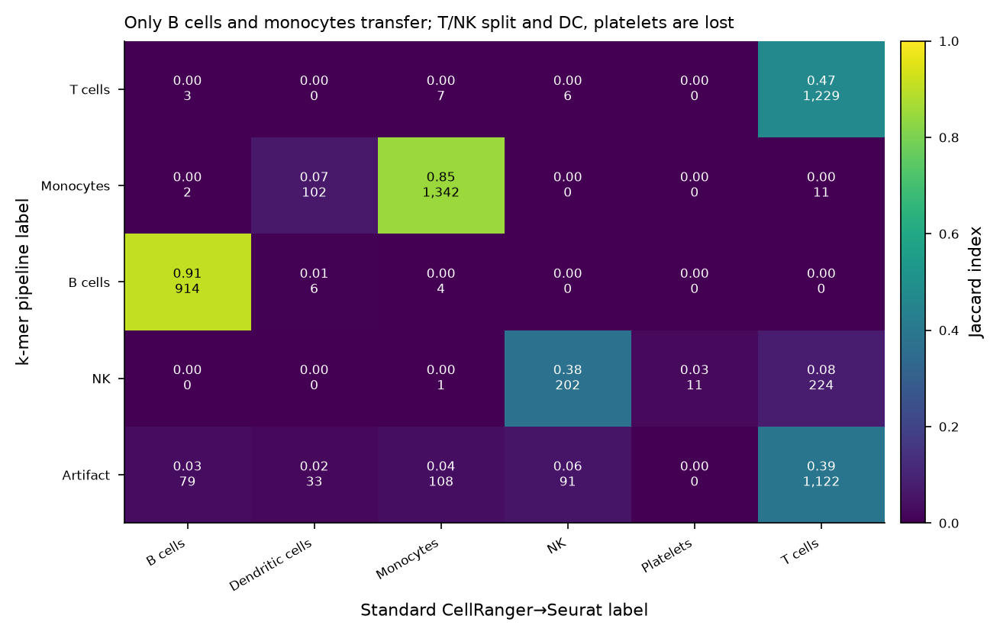

# Three-way comparison on 5K Human Donor4 PBMC

All three arms of this benchmark run on the **same** 10x dataset
(*5K Human Donor4 PBMC 3' GEM-X*). This file is the cross-arm summary; each
arm's own results live in its folder.

| | `standard-gene-based-pipeline-PBMC/` | `mykmerpipeline-PBMC/` | `scKAR-PBMC/` |
|---|---|---|---|
| Feature | genes | 28-mers | 31-mers |
| Unit analysed | 5,580 cells | 5,531 cells | 52 pseudo-cells |
| Counting | CellRanger (UMI-collapsed) | BKC (UMI-aware) | jellyfish (**no UMI model**) |
| Primary filter | QC only | prevalence, ≥1% of cells | **reference subtraction** (GENCODE v50) |
| Clusters | 15 (res 0.4) | 8 (res 0.2) | 3 (leiden, res 0.6) |
| DE design | one-vs-rest per cluster | one-vs-rest per cluster | one bipartition, DESeq2 |
| Significant features | 13,941 genes | 89,970 k-mers → 4,162 contigs | 1,326,856 k-mers → 214 contigs |
| Assembly | — | 27 bp overlap, r ≥ 0.8 | ABySS unitigs |

## The filters select opposite populations

This is the central methodological point of the benchmark, and it is not a
tuning difference — it is a difference in *kind*:

- The k-mer pipeline filters by **prevalence** (`min_frac = 0.01`, 26.5 M
  28-mers → 474,583). A 1%-of-cells floor selects abundant transcripts;
  abundant transcripts are mature spliced mRNA; mature mRNA is exonic.
- scKAR filters by **reference membership** — it subtracts ~215 M GENCODE v50
  31-mers, so what survives is sequence *absent from the annotated
  transcriptome*.

The prevalence floor therefore removes precisely the novel / intronic /
intergenic sequence that scKAR is built to isolate.

`k` follows from this: scKAR's 31 is driven by the need for a k-mer to be
near-unique in the transcriptome for subtraction to work; the k-mer pipeline's
28 comes from BKC's `leader_len`, set against read geometry.

## Cell-identity agreement: k-mer pipeline vs standard

Both arms label the same individual barcodes, so agreement is well defined.
5,497 barcodes are shared.

| k-mer label | best standard match | Jaccard |
|---|---|---|
| B cells | B cells | **0.91** |
| Monocytes | Monocytes | **0.85** |
| T cells | T cells | 0.47 |
| NK | NK | 0.38 |
| (none) | Dendritic cells | 0.07 — 102/142 absorbed into monocytes |
| (none) | Platelets | 0.00 — 11/17 absorbed into NK |

The two abundant lineages transfer well. The rest degrade: 1,122 standard
T cells fall into the k-mer pipeline's rRNA/high-MT artifact clusters and 224
into its NK cluster, and neither dendritic cells nor platelets get a cluster at
all. This matches the earlier finding that PPBP, PF4, FCER1A, CD1C and the
CD4/CD8 markers have zero marker k-mers anywhere — they never clear the
prevalence floor.

Tables: `kmer_vs_std_jaccard.csv`, `kmer_vs_std_contingency.csv`.

### Why scKAR is absent from this matrix

scKAR assigns no cell types. Its stages are clustering → bipartition → DE
k-mers → contigs; identity enters only as the expression matrix used to define
conditions and leaves as unlabelled cluster integers. It also ran on 52
pseudo-cells rather than barcodes, and those pools were built *from* the
standard pipeline's labels — so a scKAR-vs-standard agreement matrix would be
circular by construction.

What scKAR does show is how its expression clustering **groups** pure pools: it
recovered the lymphoid/myeloid boundary unsupervised, merging T with NK and
monocytes with DC, and separating B cells.

## Caveats that travel with these numbers

1. **scKAR has no UMI deduplication** — it counts reads, including PCR
   duplicates. The other two arms count UMI-collapsed molecules.
2. **scKAR's A/B file labels are inverted** relative to its condition labels
   (verified empirically, see `scKAR-PBMC/logs/ab_direction.txt`): `A_contigs`
   are myeloid-enriched, `B_contigs` lymphoid-enriched.
3. **scKAR's multiple-testing correction is per chunk**, not global; the
   contig-level harmonic-mean p-values are the defensible unit.
4. **scKAR did not run at single-cell resolution** here, so its feature counts
   are not directly comparable to the per-cell arms' — a 52-sample two-group
   contrast is better powered per sample than a one-vs-rest test over
   thousands of cells.
5. The k-mer pipeline's clustering ran on the **unfiltered** 474,583-k-mer
   matrix; its intended k-means redundancy collapse was never applied.
