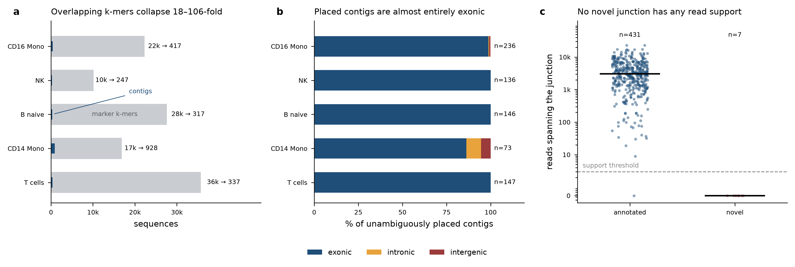

# Aim 1 — Non-exonic transcriptional signatures via contig assembly and alignment

**Dataset:** 5K Human Donor4 PBMC, 3' GEX (10x gem-x), 4 lanes
**Pipeline:** `kmer-scRNAseq-pipeline` (BKC k=28, cbc 16, umi 12) on UCLA Hoffman2
**Input to this aim:** 139,269 marker rows / 89,970 unique 28-mers from the 8-cluster
Seurat run (job 15231823), of which 132,874 rows pass `p_val_adj < 0.05`

## Headline

At the pipeline's current configuration (`min_frac = 0.01`, i.e. a k-mer must appear in
≥55 of 5,562 barcodes), **cell-type-specific marker k-mers do not yield a non-exonic
transcriptional signature.** Of 738 contigs that place unambiguously in the five
biological clusters, 725 are exonic, 7 intronic and 6 intergenic — **1.8% non-exonic**.
T cells, B naive and NK are 100% exonic with no exceptions. All 438 contig-defined splice
junctions that pass filtering are either already annotated in GENCODE v41 (431) or
unsupported by a single read (7).

This is a negative result with a mechanical explanation, not a failure of execution: a
prevalence floor of 1% of cells selects abundant transcripts, abundant transcripts are
mature spliced mRNA, and mature mRNA is exonic by construction. Intronic and intergenic
transcription is lower-abundance by nature and is removed before the markers are called.

## Upstream clustering figures (`results/clustering/`)

The 8-cluster Seurat run these contigs derive from (job 15231823; `min_frac = 0.01`
matrix, 474,583 k-mers x 5,531 cells after `min.features = 100`):

| File | Content |
|---|---|
| `umap_cluster.pdf/.png` | UMAP coloured by Louvain cluster (resolution 0.2) |
| `umap_celltype.pdf/.png` | the same UMAP with the annotations from `metadata/annotation.csv` |
| `umap_general_celltype.png` | collapsed labels (T / Monocyte / B / NK / Artifact) |
| `umap_origin.pdf` | UMAP coloured by lane of origin |
| `quality_by_cluster.pdf`, `quality_by_origin.pdf` | nCount/nFeature QC violins. `percent.mito` is absent by construction: row names are k-mers, so `^MT-` never matches |
| `dotplot_cluster_markers.pdf/.png` | top marker k-mers per cluster, labelled by sequence |
| `top_markers_per_cluster.csv`, `cluster_gene_summary.csv` | marker k-mers with the genes they align to |
| `cells_per_celltype.csv` | cell counts per annotated type |

Clusters 3 and 4 are rRNA/TSO artifact and cluster 7 is high-mitochondrial; all three are
excluded from every claim in this report.

## What was done

### 1. Contig assembly (`assemble_contigs.py`)
K-mers were joined on a shared k-1 = 27 bp suffix-prefix overlap, with each candidate
merge gated on the Pearson correlation of the two k-mers' per-cell count vectors across
all 5,562 cells (primary threshold r ≥ 0.8). Unitig walks break at branch points, so a
contig is a maximal unambiguous path — no greedy or consensus extension.

| Cluster | Label | marker k-mers | contigs | multi-k-mer | ≥56 bp | max length | collapse |
|---|---|---|---|---|---|---|---|
| 0 | T cells | 35,752 | 337 | 274 | 179 | 761 bp | 99.1% |
| 1 | CD14 Mono | 16,852 | 928 | 627 | 76 | 1,595 bp | 94.5% |
| 2 | B naive | 27,620 | 317 | 238 | 149 | 571 bp | 98.9% |
| 3 | rRNA artifact | 7,317 | 657 | 211 | 21 | 1,023 bp | 91.0% |
| 4 | rRNA artifact | 8,148 | 841 | 342 | 29 | 725 bp | 89.7% |
| 5 | NK | 10,166 | 247 | 200 | 86 | 365 bp | 97.6% |
| 6 | CD16 Mono | 22,274 | 417 | 292 | 139 | 839 bp | 98.1% |
| 7 | Low quality (high MT) | 4,745 | 418 | 124 | 19 | 1,444 bp | 91.2% |

**132,874 k-mers → 4,162 contigs (96.9% collapse).** The correlation gate is nearly
inert: contig counts move <10% across r = 0.5 → 0.9 (cluster 0: 350 / 344 / 337 / 369).
Overlapping k-mers essentially always co-vary, so the overlap structure does the work and
the gate functions as a safety check. This quantifies the redundancy seen earlier at the
marker level, where the top 10 markers per cluster collapsed to 1–4 distinct sequences.

### 2. Genomic placement (`blat_contigs.job`, `blat_rescue.job`, `psl_annotate.py`)
BLAT against GRCh38 no-alt analysis set placed 1,544 of 4,162 contigs at ≥90% query
coverage. The 2,618 unplaced were 90.6% shorter than 41 bp (59.7% exactly 28 bp) and fail
BLAT's two-perfect-11-mer-tile seeding, so they were re-run with exact bowtie matching,
rescuing 886. **2,430 placed, 1,732 unplaced.** Allowing up to 2 mismatches recovers only
61 of the remaining 1,732 (3.5%), so ~1,671 contigs are genuinely absent from GRCh38 —
consistent with the adapter/TSO and chimeric sequence identified earlier.

Category precedence: **exonic** if any aligned block overlaps a GENCODE exon, else
**intronic**, else **intergenic**.

**All placements (multi-mapping included):**

| Cluster | Placed | Exonic | Intronic | Intergenic | non-exonic | multi-mapping |
|---|---|---|---|---|---|---|
| 0 T cells | 271 | 261 | 9 | 1 | 3.7% | 45.8% |
| 1 CD14 Mono | 763 | 138 | 370 | 255 | 81.9% | 90.4% |
| 2 B naive | 273 | 270 | 2 | 1 | 1.1% | 46.5% |
| 3 rRNA artifact | 121 | 8 | 21 | 92 | 93.4% | 86.8% |
| 4 rRNA artifact | 311 | 32 | 136 | 143 | 89.7% | 91.3% |
| 5 NK | 227 | 203 | 16 | 8 | 10.6% | 40.1% |
| 6 CD16 Mono | 378 | 310 | 43 | 25 | 18.0% | 37.6% |
| 7 Low quality | 86 | 42 | 2 | 42 | 51.2% | 65.1% |

**Unambiguous placements only (single best locus) — the defensible table:**

| Cluster | Unambiguous | Exonic | Intronic | Intergenic | % non-exonic |
|---|---|---|---|---|---|
| 0 T cells | 147 | 147 | 0 | 0 | 0.0 |
| 1 CD14 Mono | 73 | 63 | 6 | 4 | 13.7 |
| 2 B naive | 146 | 146 | 0 | 0 | 0.0 |
| 5 NK | 136 | 136 | 0 | 0 | 0.0 |
| 6 CD16 Mono | 236 | 233 | 1 | 2 | 1.3 |
| 3 rRNA artifact | 16 | 8 | 5 | 3 | 50.0 |
| 4 rRNA artifact | 27 | 7 | 16 | 4 | 74.1 |
| 7 Low quality | 30 | 30 | 0 | 0 | 0.0 |

CD14 Mono's apparent 81.9% non-exonic fraction collapses to 13.7% once multi-mapping
contigs are excluded: 90.4% of its placements land in hundreds of loci, and whichever copy
falls outside an exon is an accident of reporting order, not evidence of transcription.

### 3. Splice junctions (`junctions.py`, `hisat_index.job`, `hisat_sj.job`)
256 contigs had a spliced best placement, giving 438 candidate junctions (both flanks
≥8 bp, implied intron ≥20 bp). Against 400,927 GENCODE v41 junctions: **431 annotated
(all canonical), 7 novel.**

Read-level support came from HISAT2 (index built for GRCh38 no-alt) aligning 17,186,615
reads — every 3rd read of lane 1 R2, the 10x cDNA mate, at 90.46% alignment — yielding
158,663 observed junctions.

| Status | n | supported (≥3 reads) | median support | max |
|---|---|---|---|---|
| annotated | 431 | **430** | 3,046 | 22,855 |
| novel | 7 | **0** | 0 | 0 |

Every novel junction has exactly zero supporting reads:

| Junction | Cluster | Motif | Implied intron | Reads |
|---|---|---|---|---|
| chr9:19,201,040–19,380,189 | 0 T cells | CT-AC | 179,149 bp | 0 |
| chr11:39,965,769–39,965,824 | 4 artifact | AC-GA | 55 bp | 0 |
| chr3:63,912,449–63,912,640 | 3 artifact | GG-GC | 191 bp | 0 |
| chrUn_GL000220v1:116,586–116,853 | 3, 4 artifact | AC-CA | 267 bp | 0 |
| chrX:125,180,153–125,180,173 | 3 artifact | GG-GG | 20 bp | 0 |
| chrX:125,180,184–125,180,206 | 3 artifact | AA-TG | 22 bp | 0 |

The single canonical candidate (chr9, CT-AC = GT-AG on the minus strand) implies a 179 kb
intron with no read crossing it — a BLAT mis-join of two separate short alignments, not
splicing. Two others sit on `chrUn_GL000220v1`, an unplaced scaffold carrying rRNA genes.
**No novel junction survives.** The 430/431 corroboration rate on annotated junctions is
strong positive control that assembly and placement recover real splicing.

### 4. Regulatory elements (`ccre_fetch.job`, `ccre_overlap.job`, `ccre_fix.job`)
ENCODE SCREEN V4 registry (`Registry-V4/GRCh38-cCREs.bed`, 2,348,854 elements). 917 of
2,430 placed contigs (37.7%) overlap a cCRE across 1,270 block/element pairs: pELS 580,
dELS 438, PLS 185, CA 29, TF 21, CA-CTCF 9, CA-H3K4me3 7, CA-TF 1.

**This overlap is mostly not evidence of regulatory transcription.** Promoters sit at gene
5' ends, first exons immediately downstream, and 98% of confidently placed contigs are
exonic — so PLS/pELS overlap is expected for any set of sequences drawn from the start of
expressed genes. Note also that dELS is defined by distance from a TSS, so internal and 3'
exons of long genes carry dELS annotations routinely.

The aim's actual test — contigs that are **non-exonic and overlap a distal-enhancer-like
element**, unambiguously placed — returns **8 contigs across all clusters and exactly 1 in
the biological clusters**: `c1_contig732_n1_L28` (CD14 Mono, intronic,
chr10:130,157,489–130,157,517, element EH38E1511233), itself a 28 bp single-k-mer contig.

Cell-type restriction used ENCODE per-biosample annotations — T cells ← T-cell,
CD14 Mono ← CD14-positive monocyte, B naive ← B cell, NK ← natural killer cell
(CD16 Mono has no dedicated set). **Caveat:** these files carry per-biosample *activity
states* (`High-H3K4me3`, `High-H3K27ac`, `CA-only`, `Low-DNase`), not the PLS/pELS/dELS
*types*, so type comes from the registry and activity from the biosample file. Contigs
overlapping an active-state element: NK 577, CD14 Mono 437, B naive 0 (that biosample's
file reports no High states, so its restriction is uninformative rather than negative).

## Limitations

1. **The prevalence threshold is the binding constraint.** `min_frac = 0.01` discards
   98.2% of distinct k-mers (26,493,145 → 474,583), and it discards them in the direction
   that matters: low-abundance intronic and intergenic transcription. Lowering it keeps
   778,357 k-mers at 0.005 and 2,989,019 at 0.001.
2. **Multi-mapping dominates the raw non-exonic signal.** 1,619 of 2,430 placements are
   ambiguous. Any non-exonic claim must be made on the unambiguous subset, and a repeat
   mask belongs upstream of a future non-exonic run.
3. **41.6% of contigs never place.** 1,732 of 4,162, and only 61 of those are within 2
   mismatches of the genome — largely adapter/TSO-derived and chimeric sequence.
4. **Junction detection is length-limited.** Only 698 contigs reach 56 bp, so most cannot
   span a junction at all; the junction analysis speaks for the long tail, not the set.
5. **Read support is from a subsample.** 17.2M reads of one lane, so absence of support
   for a weakly used junction would not be conclusive — though zero reads at a median
   annotated support of 3,046 is not a sensitivity problem.
6. **Three of eight clusters are technical.** Clusters 3, 4 (chr21 acrocentric rDNA,
   10x TSO) and 7 (mitochondrial) are reported separately and excluded from biological
   conclusions.
7. **Rare populations are absent entirely.** No platelet, dendritic-cell, erythroid or
   HSPC cluster exists in this clustering, and CD4/CD8 subtyping is impossible — the same
   prevalence threshold is responsible.

## What would make Aim 1 answerable

Re-run matrix construction at `min_frac = 0.005` or `0.001`, add a repeat mask (RepeatMasker
or the UCSC rmsk track) before placement so recovered intronic/intergenic contigs are
trustworthy, and trim the 10x TSO upstream of k-mer counting so the adapter-driven clusters
stop consuming a quarter of the cells. The assembly, placement, junction and cCRE machinery
in this directory all run unchanged on a lower-threshold matrix; only the matrix changes.
