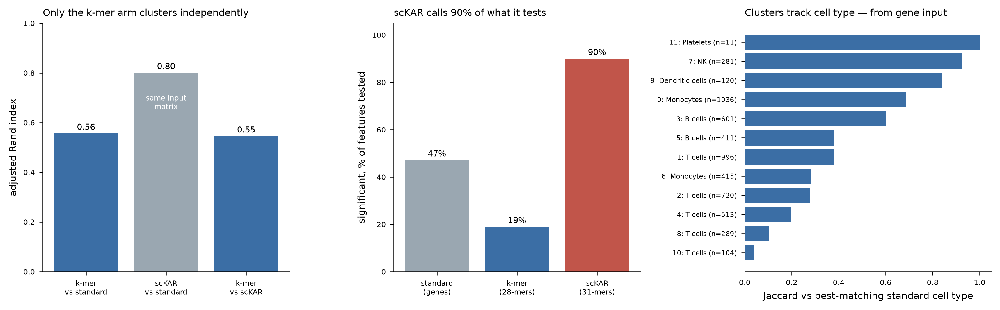

# Three-way comparison, v2 — all three arms on 5,580 real barcodes

Supersedes `../pipeline-comparison/`. The v1 comparison could not place scKAR in
the cell-identity analysis at all: it had run on 52 pseudo-cells built *from* the
standard pipeline's own labels. scKAR has since been run per-cell on every
QC-passing barcode (`../scKAR-PBMC/v3-5580bc/`), so for the first time all three
arms label the same individual cells and a genuine three-way comparison is
possible.

**5,497 barcodes are shared by all three arms** (standard 5,580, scKAR 5,580,
k-mer 5,531).

## The arms

| | standard | k-mer pipeline | scKAR |
|---|---|---|---|
| Feature | genes | 28-mers | 31-mers |
| Unit analysed | 5,580 cells | 5,531 cells | 5,580 cells |
| Counting | CellRanger (UMI-collapsed) | BKC (UMI-aware) | jellyfish + UMI collapse* |
| Primary filter | QC only | prevalence, ≥1% of cells | reference subtraction (GENCODE v50) |
| **Clustering input** | **gene expression** | **k-mer counts** | **gene expression** |
| Clusters | 15 (res 0.4) | 8 (res 0.2) | 12 (res 0.6) |
| DE design | one-vs-rest per cluster | one-vs-rest per cluster | 9 distinct bipartitions, glmGamPoi |
| Cell types assigned | 6 | 7 (2 artifact classes) | none |

\* UMI collapsing is our addition to scKAR, which has no UMI model; it puts all
three arms on UMI-collapsed counts. See `../scKAR-PBMC/v3-5580bc/README.md`.

## Read the clustering-input row before the agreement numbers

| partitions compared | ARI | NMI |
|---|---|---|
| k-mer vs standard | 0.556 | 0.604 |
| **scKAR vs standard** | **0.801** | **0.846** |
| k-mer vs scKAR | 0.545 | 0.619 |

scKAR scores far higher against the standard pipeline than the k-mer pipeline
does — and that comparison is **not** evidence that 31-mers recover cell
identity better than 28-mers. scKAR was run in its `GENE_EXPRESSION` clustering
mode, which clusters cells using *the same CellRanger gene matrix the standard
arm uses*. Its ARI of 0.80 against the standard pipeline therefore measures two
Leiden runs on one matrix at different resolutions. It is a sanity check, not a
cross-modality result.

Only the k-mer pipeline clusters cells from its own alignment-free features. Its
ARI of 0.556 against the standard arm is the only genuine cross-modality
agreement number in this table, and it is the one to quote.

scKAR does support clustering on the k-mer abundance matrix instead; running it
that way would make the comparison meaningful. That has not been done.

### What scKAR's clusters correspond to

Given the caveat above, this maps scKAR's clusters onto standard cell types
(Jaccard, best match per cluster):

| scKAR cluster | best standard match | Jaccard | n |
|---|---|---|---|
| 11 | Platelets | **1.000** | 11 |
| 7 | NK | **0.927** | 281 |
| 9 | Dendritic cells | **0.838** | 120 |
| 0 | Monocytes | 0.688 | 1,036 |
| 3 | B cells | 0.602 | 601 |
| 5 | B cells | 0.381 | 411 |
| 1 | T cells | 0.379 | 996 |
| 6 | Monocytes | 0.284 | 415 |
| 2 | T cells | 0.278 | 720 |
| 4 | T cells | 0.196 | 513 |
| 8 | T cells | 0.104 | 289 |
| 10 | T cells | 0.040 | 104 |

Worth noting against the v1 finding: the k-mer pipeline gave platelets and
dendritic cells **no cluster at all**, because the markers never clear its
prevalence floor. With gene-expression input, scKAR separates both cleanly
(platelets perfectly). T cells fragment across six scKAR clusters, which is a
resolution effect rather than a failure.

## Feature funnel

| stage | standard (genes) | k-mer (28-mers) | scKAR (31-mers) |
|---|---|---|---|
| Tested for DE | 29,567 | 474,583 | 83,549 |
| Significant (distinct) | 13,941 | 89,970 | 75,179 |
| Assembled contigs (distinct) | — | 4,162 | 1,838 |
| Placed on hg38 | — | 2,430 | 1,596 |
| Overlap a GENCODE gene | — | — | 550 |

**scKAR calls 90% of everything it tests significant** (75,179 of 83,549),
against 47% for the standard pipeline and 19% for the k-mer pipeline. That is a
consequence of its design rather than a bug: the Fisher F-test pre-filter
already selects k-mers with high between-group variance, so the DE test that
follows is applied to a set enriched for exactly what it looks for.

*Provenance of the 83,549:* it is the number of 31-mers surviving the Fisher
F-test, i.e. the input to the DE stage — the row counts of
`data/f_test_results/f_test_result_1..6.csv` (11,439 + 13,285 + 16,804 + 20,660
+ 14,068 + 7,293). The chunks partition the k-mer space, so the distinct count
equals the sum (verified: `cut -f1 | sort -u | wc -l` also returns 83,549).
Every bipartition tests this same set, which is why the per-bipartition
significant counts must be unioned rather than summed.

### Distinct vs summed counts

scKAR's per-bipartition tables sum to 451,196 significant k-mers and 3,707
contigs across 10 bipartition-arms, but k-mers and contigs recur across
contrasts. The **distinct** figures are 75,179 k-mers and 1,838 contigs, and
those are what the table reports. Bipartitions 8 and 9 are mirror images of each
other, so there are 9 distinct contrasts, not 10.

## Where scKAR's contigs land

Of 1,596 distinct placed contigs, **911 (57.1%) have their best locus on
`chrUn_GL000220v1`** — the unplaced scaffold carrying the 45S rDNA repeat array
— and none of those overlap an annotated gene. Excluding that scaffold and chrM
leaves **617** contigs; 550 of the 1,596 overlap a gene at all, and only 286 map
to a single locus.

A gene-level three-way comparison should therefore be restricted to those 617,
not run against the full contig set. The likely mechanism — reference
subtraction against a *transcriptome* leaves rDNA repeat sequence behind — is
discussed in `../scKAR-PBMC/v3-5580bc/README.md`.

## What changed from v1

- scKAR enters the cell-identity analysis for the first time (52 pseudo-cells → 5,580 barcodes).
- All three arms now sit on UMI-collapsed counts, so abundance is comparable.
- scKAR's contigs are annotated; v1 could not run BLAT on this OS.
- scKAR counts are reported as distinct features; v1 reported sums over contrasts.

## Files

| file | contents |
|---|---|
| `comparison_v2.png` | the figure above |
| `pipeline_summary_v2.csv` | the arms table |
| `partition_agreement.csv` | ARI / NMI for every pair |
| `feature_funnel_v2.csv` | the funnel |
| `sckar_vs_std_jaccard.csv` | scKAR cluster × standard cell type |
| `kmer_vs_std_jaccard_v2.csv` | k-mer cell type × standard cell type |
| `three_way_barcodes.csv` | per-barcode join key for all three arms |
| `sckar_distinct_contig_annotation.csv` | scKAR contigs deduplicated across contrasts |

## Not done

- Gene-level overlap between the three arms' DE features (needs the k-mer arm's
  gene calls joined to scKAR's 617 non-repeat contigs).
- scKAR clustered on its own k-mer matrix, which is what would make the
  agreement numbers a real cross-modality comparison.
