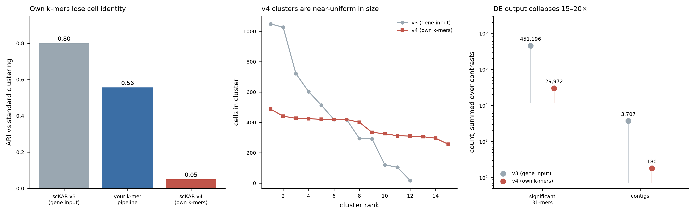

# Three-way comparison, v3 — with scKAR clustered on its own k-mers

Supersedes `../pipeline-comparison-v2/`. v2 reported that scKAR agreed with the
standard pipeline at ARI 0.801 and flagged, as a caveat, that scKAR had been run
in `GENE_EXPRESSION` mode and was therefore clustering on *the same CellRanger
matrix the standard arm uses*. v3 replaces that caveat with a measurement:
scKAR was re-run clustering on its own reference-subtracted 31-mers
(`../scKAR-PBMC/v4-5580bc-kmerclustering/`), changing nothing else.

## Headline

| clustering input | ARI vs standard clustering | ARI vs standard cell type |
|---|---|---|
| scKAR v3 — CellRanger gene matrix | **0.800** | 0.430 |
| **scKAR v4 — scKAR's own 31-mers** | **0.050** | **0.028** |
| k-mer pipeline — its own 28-mers | **0.556** | — |

Measured on the 5,497 barcodes shared by all arms. scKAR v4 also agrees with
scKAR v3 at ARI 0.052 and with the k-mer pipeline at 0.060 — chance level
throughout.

**The v2 number was an artifact of the shared input, and v3 confirms it by
direct measurement.** When scKAR is given its own features, its clusters carry
essentially no information about cell identity.

**The k-mer pipeline is the control that makes this interpretable.** It reaches
ARI 0.556 against the standard arm using only its own 28-mer counts, so this is
not a statement about k-mers being unable to resolve cell types. The difference
between the two alignment-free arms is the filter:

- The k-mer pipeline keeps k-mers by **prevalence** (≥1% of cells), which
  selects abundant transcripts — exactly the sequence that distinguishes cell
  types.
- scKAR keeps k-mers by **absence from the reference transcriptome**, which
  removes that same sequence by construction.

## Supporting evidence

**Cluster structure.** scKAR v4 produces 15 clusters spanning 256–488 cells —
near-uniform, which is what partitioning without real structure looks like.
scKAR v3 on gene input produces 12 clusters spanning 17–1,049, including a
17-cell platelet cluster (Jaccard 1.000 against the standard labels) and a
dendritic-cell cluster (0.838). Neither appears in v4.

**Output volume.** Distinct significant 31-mers fall from 75,179 to 13,949 and
distinct contigs from 1,838 to 161.

**What the contigs are.** Of scKAR v4's 172 placed contigs, **137 (79.7%)** have
their best locus on `chrUn_GL000220v1`, the 45S rDNA repeat scaffold — up from
57.1% in v3. Only 6 map to a single locus; only 30 overlap any GENCODE gene.
The feature space that survives reference subtraction is largely ribosomal
repeat, and clustering on it recovers ribosomal content rather than cell type.

## Feature funnel

| stage | standard (genes) | k-mer (28-mers) | scKAR v3 (31-mers) | scKAR v4 (31-mers) |
|---|---|---|---|---|
| Tested for DE | 29,567 | 474,583 | 83,549 | — |
| Significant (distinct) | 13,941 | 89,970 | 75,179 | 13,949 |
| Contigs (distinct) | — | 4,162 | 1,838 | 161 |
| Placed on hg38 | — | 2,430 | 1,596 | 172 |
| On rDNA scaffold | — | not assessed | 911 (57.1%) | 137 (79.7%) |
| Overlap a GENCODE gene | — | not assessed | 550 | 30 |

The "on rDNA scaffold" and "overlap a gene" rows were not computed for the k-mer
arm, so its cells read "not assessed" rather than zero.

## Caveat on v4

scKAR's own `KMER_ABUNDANCE` mode cannot run at this scale — it densifies
21,235,492 k-mers × 5,580 cells (~948 GB). v4 clusters on the 139,830 k-mers
present in ≥56 cells (1%, the same floor the F-test applies). The filter uses
only per-k-mer prevalence — no labels, no clustering, nothing from the
gene-expression arm — so the independence the ARI depends on holds. It also
retains the *most* prevalent k-mers, i.e. the subset most likely to carry cell
structure, which makes the near-zero agreement a conservative result rather than
an artifact of discarding signal.

## Files

| file | contents |
|---|---|
| `comparison_v3.png` | the figure above |
| `pipeline_summary_v3.csv` | all four arms side by side |
| `partition_agreement_v3.csv` | ARI / NMI for every pair |
| `feature_funnel_v3.csv` | the funnel |
| `four_way_barcodes.csv` | per-barcode join key: standard, k-mer, scKAR v3, scKAR v4 |

## Not done

- Gene-level overlap of DE features across arms.
- The k-mer pipeline at a 0.1% prevalence floor, which tests whether its missing
  platelet and dendritic clusters are caused by the 1% threshold. That run is in
  progress and will land in `../mykmerpipeline-PBMC/v1-28mer-0.1perc/`.
