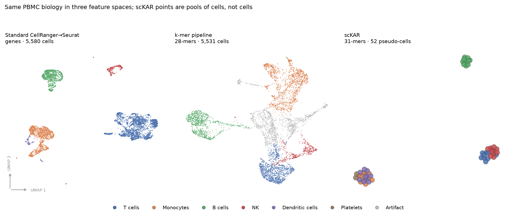
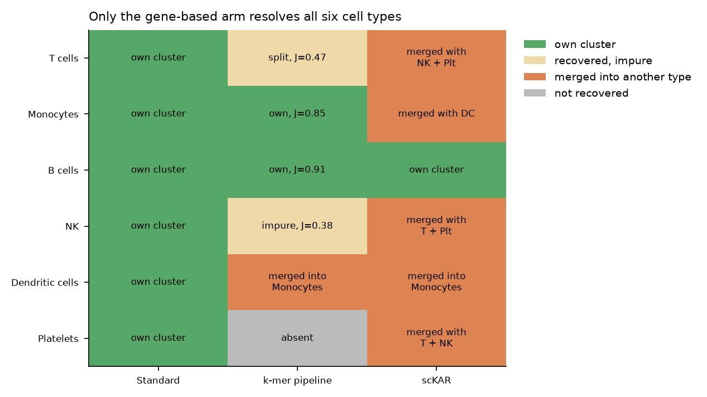
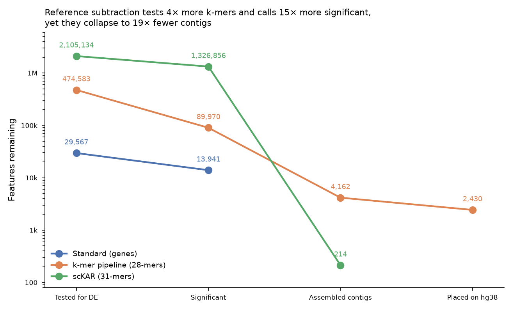

# pipeline-comparison

Cross-arm comparison of the three pipelines run on the **same** dataset,
*5K Human Donor4 PBMC 3' GEM-X*:

- `standard-gene-based-pipeline-PBMC/` — CellRanger → Seurat, genes, 5,580 cells
- `mykmerpipeline-PBMC/` — BKC 28-mers, prevalence filter, 5,531 cells
- `scKAR-PBMC/` — scKAR 31-mers, GENCODE reference subtraction, 52 pseudo-cells

`COMPARISON.md` is the written summary. The figures:

## 1. The same biology in three feature spaces

Each arm's own embedding, coloured by the standard pipeline's `GeneralCellType`
so the panels are readable against one reference. **scKAR's points are pools of
cells, not cells** — 52 pseudo-cells against 5,580 and 5,531 barcodes — so its
panel shows pool separation, not single-cell structure. Grey "Artifact" points
are the k-mer pipeline's two rRNA clusters and its high-MT cluster, which have
no counterpart in the other arms.

## 2. What each arm can actually resolve

Rows are the six standard cell types; a cell says whether that arm gave the type
its own cluster, recovered it impurely, merged it into another type, or missed
it. The k-mer column uses the Jaccard values from figure 3's table (≥0.8 own,
0.3–0.8 impure, otherwise merged/absent); the scKAR column is structural — which
types share a leiden cluster.

Two caveats on the scKAR column, which otherwise reads unfairly:

- scKAR is **not a cell-typing tool**. It has no annotation step; cluster
  identity exists only to define the DE contrast. "Merged" here means the pools
  shared a leiden cluster, which is exactly what scKAR needs for a bipartition.
- It clustered **52 points**, not thousands. Leiden at resolution 0.6 on 52
  observations will produce few clusters regardless of the biology.

The genuinely comparable statement is the k-mer column: at a 1%-of-cells
prevalence floor the two abundant lineages survive and the rare ones do not.

## 3. Where the features go

Attrition from features entering the DE test through to genome placement, log
axis. The two k-mer arms start orders of magnitude apart and end closer than
they start: scKAR's reference subtraction leaves ~4× more k-mers to test than
the prevalence floor does, and ~15× more significant ones, yet those collapse to
**214 contigs against 4,162** — because the surviving non-reference k-mers are
scattered and rarely chain into anything long. Median scKAR contig length is 56
and 53 bp for the two sets, barely above k=31.

"Placed on hg38" is only defined for the k-mer pipeline; scKAR emits raw BLAT
`.psl` lines that are not deduplicated to a per-contig best locus.

## Agreement matrix

`kmer_vs_std_jaccard.csv` / `kmer_vs_std_contingency.csv` back figure 2, over
the 5,497 barcodes both arms label. scKAR is absent from that matrix by
construction — see `COMPARISON.md`.

## Source tables

`celltype_resolution.csv`, `feature_funnel.csv` hold the plotted values.
