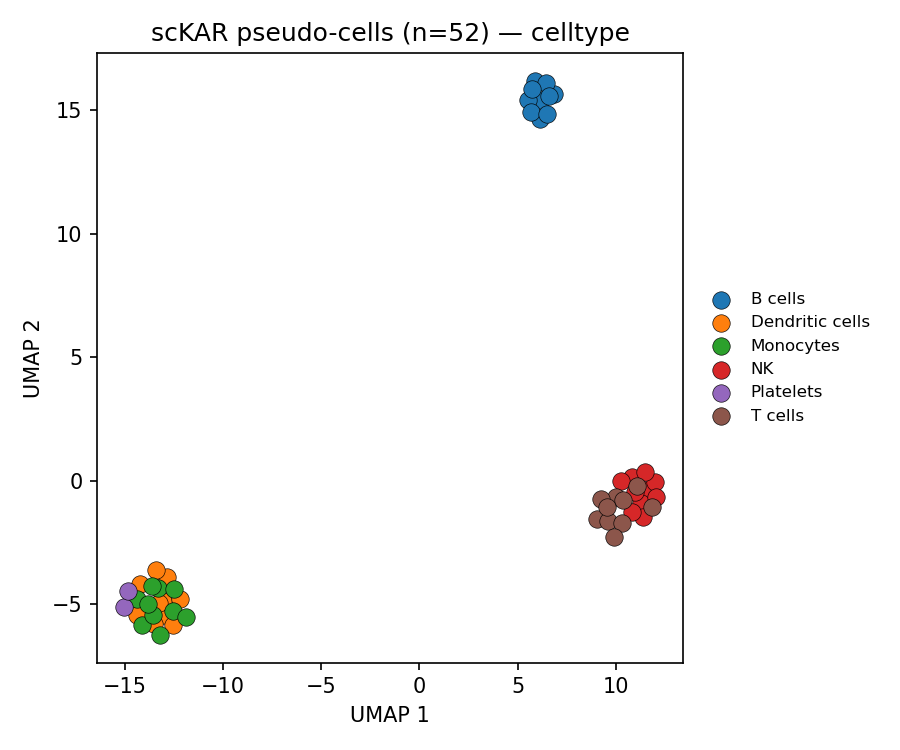
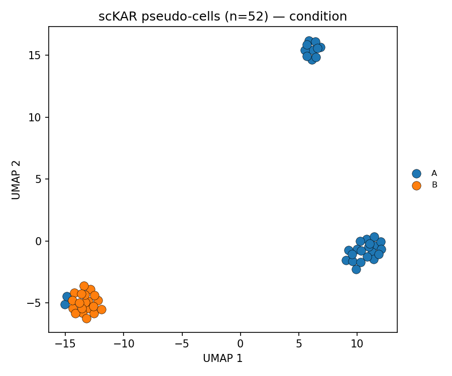

# scKAR on 5K Human Donor4 PBMC (pseudo-cell adaptation)

Reference-free k-mer differential expression with
[scKAR](https://github.com/RedwanulKarim612/scKAR) on the same 10x PBMC dataset
used by the other two arms of this benchmark.

## Why pseudo-cells

scKAR expects **one deep FASTQ per cell** (plate / SMART-seq). This dataset is
10x: 5,580 barcodes at ~38k reads each. Running it per-cell is not possible —

- `jellyfish count` is followed by `dump -L 2`, which drops k-mers seen once in
  a cell. At 10x depth nearly every 31-mer in a single barcode is a singleton,
  so per-cell counting would discard almost everything.
- scKAR's F-test stage writes a **dense** k-mer × cell matrix (2.1 GB for 118
  cells); 5,531 cells is intractable.

So barcodes were pooled into **52 pseudo-cells** — 10 independent random pools
per cell type (2 for platelets), using the standard pipeline's `GeneralCellType`
calls, seed 7. Each pool reaches SMART-seq-like depth. This is faithful to
scKAR's design, which already consumes a gene × cell expression matrix to define
its conditions.

**This is not single-cell resolution.** The DE contrast is between groups of
cells, not between cells.

## Input

| | |
|---|---|
| Reads | R2 cDNA from 4 lanes, demultiplexed by 16 bp barcode |
| Read pairs processed | 207,756,466 |
| Matched a filtered barcode | 185,502,266 (**89.3%**) |
| Pseudo-cell FASTQs | 52, 9.4 GB gzipped |
| Expression matrix | 38,606 genes × 52 pseudo-cells (CPM, gene-major) |
| Reference for subtraction | GENCODE v50 transcript 31-mers (~215 M) |

**No UMI deduplication.** Reads are routed by barcode only, keeping PCR
duplicates, because scKAR has no UMI model — its source data was SMART-seq. The
standard CellRanger arm and the BKC k-mer arm both count UMI-collapsed
molecules. Keep this asymmetry in mind for any abundance-derived comparison.

## Configuration

`FILTER_REFERENCE_KMERS=true`, `MODE=GENE_EXPRESSION`, leiden, `N_PCS=20`,
`N_NEIGHBORS=10`, `RESOLUTION=0.6`, `MIN_ROW_THREDSHOLD=10`, `LOG2FC=1.0`,
`PVAL=0.05`, `PVAL_COMBINATION_METHOD=hmp`. Two parameters differ from the
118-cell RCC run and were scaled to 52 cells: `N_PCS` (was 40) and
`MIN_ROW_THREDSHOLD` (was 20, kept at the same ~19% prevalence fraction).
Full file in `metadata/config.env`.

## Results

### Clustering — the lymphoid/myeloid split, recovered unsupervised

Leiden found exactly **3 clusters**, and every pool fell cleanly into one:

| Leiden cluster | Pools | Composition |
|---|---|---|
| 0 | 22 | NK (10), T cells (10), Platelets (2) |
| 1 | 20 | Monocytes (10), Dendritic cells (10) |
| 2 | 10 | B cells (10) |

Three dendrogram leaves give one internal edge, so there is a single
bipartition: **condition A = clusters 0+2 (32 lymphoid + platelet pools)** vs
**condition B = cluster 1 (20 myeloid pools)**.





### Differential k-mers and contigs

| | A_* files | B_* files |
|---|---|---|
| DE 31-mers (padj ≤ 0.05, \|log2FC\| ≥ 1) | 939,035 | 387,821 |
| ABySS contigs | **167** | **47** |
| Contig total bp | 10,012 | 2,857 |
| Contig length min / median / max | 27 / 56 / 252 | 27 / 53 / 165 |
| BLAT hg38 alignment lines | 4,843 | 1,698 |

1,326,856 DE k-mers in total, collapsing to **214 contigs / 12,869 bp**.

### ⚠ The A/B labels are inverted — verified on this run

`deseq2_glmgamPoi.R` reads `results(dds, name="conditionB")`, but
`merge_deseq_results.py` writes log2FC>0 to `A_kmers` and <0 to `B_kmers`. The
file names are therefore **inverted relative to the condition labels**.

This was confirmed empirically here, not assumed (`logs/ab_direction.txt`): the
five largest positive-log2FC k-mers all land in `A_kmers`, and their per-pool
abundances are non-zero in Mono_00 / Mono_01 / DC_00 and **exactly zero** in
T_00 / B_00 / NK_00. The five most negative land in `B_kmers` and show the
opposite pattern.

**So, reading through the inversion:**

- `A_kmers` / `A_contigs` (167) are **myeloid-enriched** (monocytes + DC)
- `B_kmers` / `B_contigs` (47) are **lymphoid-enriched** (B, NK, T, platelets)

Anyone comparing methods against these files needs this.

### Statistical caveat

Multiple-testing correction is **per chunk**, not global. Each of the 50 DESeq2
tables is its own run, so `padj` is a BH correction within that chunk, and
`merge_deseq_results.py` concatenates already-adjusted values — there is no
correction across the 1.33 M k-mers tested. Combined with the fact that adjacent
31-mers from one transcript are highly correlated, the **contig-level
harmonic-mean p-values are the defensible unit of reporting**, not the raw
k-mer count.

## Contents

```
results/contigs/     A_/B_ contigs fasta + tsv, harmonic-mean p-values, BLAT hg38 .psl
results/kmers/       A_kmers.fasta.gz, B_kmers.fasta.gz (gzipped DE k-mer sets)
results/clustering/  pseudo-cell UMAPs by cell type / leiden / condition (PNG+PDF),
                     plus scKAR's own native umap-leiden and dendrogram-leiden
metadata/            cluster.csv, bipartition_0.csv, umap_coords_sckar.csv,
                     celltype_by_leiden.csv, celltype_by_condition.csv,
                     pseudocell_summary.csv, pseudocell_map.csv, config.env
logs/                stats.txt, ab_direction.txt, full pipeline log
scripts/             demux_lane.py, make_expression.py, sckar_umap.py, jobSK.sh
```

Excluded as too large / regenerable: `filtered_kmers.tsv` (170 MB, the full
per-k-mer DESeq2 table), the per-cell jellyfish tables and the adjacency chunks.
