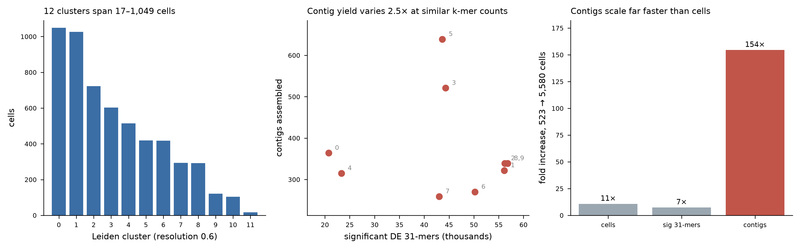

# scKAR on PBMC — v3, all 5,580 barcodes

scKAR run end to end on the 5K Human Donor4 PBMC 3' GEM-X dataset using **every
QC-passing barcode as its own cell**. The original 10x lane FASTQs are inputs
only; read sequences are never altered, only partitioned by barcode and
collapsed by UMI.

This supersedes `../v2-523bc/`, which used a 523-barcode stratified subsample
(9.4% of the cells) and is retained for comparison. See *Why the subset was
misleading* below — it matters for interpreting that folder.



## Inputs

| | |
|---|---|
| cells | 5,580 (all QC-passing barcodes in `barcode_celltype_STD.csv`) |
| lane read pairs | 207,756,466 across L001–L004 |
| matched to a wanted barcode | 185,502,266 (89.2–89.4% per lane) |
| reads after UMI collapsing | 98,584,245 |
| PCR duplicate fraction | 46.86% |
| per-cell reads | 1,097 – 66,651 (no empty cells) |

Cell-type composition: T cells 2,624 · Monocytes 1,480 · B cells 1,006 ·
NK 311 · Dendritic cells 142 · Platelets 17.

## Results

12 Leiden clusters at resolution 0.6 (1,049 / 1,027 / 722 / 603 / 514 / 419 /
418 / 294 / 292 / 121 / 104 / 17 cells), producing 10 bipartitions.

| bipartition | sig. 31-mers (A) | sig. 31-mers (B) | contigs (A) | contigs (B) |
|---|---|---|---|---|
| 0 | 8,674 | 12,074 | 138 | 226 |
| 1 | 40,583 | 15,563 | 318 | 4 |
| 2 | 40,381 | 15,819 | 336 | 3 |
| 3 | 24,466 | 19,832 | 12 | 509 |
| 4 | 8,716 | 14,601 | 0 | 315 |
| 5 | 18,688 | 24,966 | 4 | 635 |
| 6 | 17,002 | 33,230 | 2 | 268 |
| 7 | 11,715 | 31,292 | 1 | 258 |
| 8 | 41,181 | 15,616 | 337 | 2 |
| 9 | 15,616 | 41,181 | 2 | 337 |

**Totals: 451,196 significant DE 31-mers, 3,707 contigs.**

### Caveats on reading this table

- **Bipartitions 8 and 9 are mirror images** of one another (A and B swapped),
  so there are at most 9 distinct contrasts, not 10.
- **The A/B split is strongly asymmetric** in most bipartitions. The v1 arm
  documented an A/B label inversion verified empirically
  (`../v1-pseudocell/logs/ab_direction.txt`); direction should be re-checked
  here before any biological claim is attached to an arm.
- **Contigs are not annotated.** `blat` on this cluster fails with
  `libmysqlclient.so.18: cannot open shared object file`, so contig-to-genome
  mapping and gene assignment were not run.

## Why the subset was misleading

The 523-cell run produced 61,851 significant k-mers but only **24** contigs.
At 5,580 cells the same pipeline produces 451,196 k-mers and **3,707** contigs.
Going 10.7× in cells multiplied significant k-mers by 7.3× but contigs by 154×.

That super-linear jump is consistent with per-cell k-mer coverage being too
sparse at 523 cells for 31-mers to chain into contigs at the 27-mer overlap
ABySS requires: the differential signal was present, but the assembly step had
too little overlapping sequence to join. The 24-contig figure is a property of
the subsample, not of scKAR, and should not be cited as the latter.

## Deviations from scKAR as published

scKAR's Methods define its input as "raw demultiplexed (cell-specific) sequence
reads, provided in FASTA/FASTQ format". The paper never mentions barcodes, UMIs,
10x or droplet protocols — the terms do not appear in its text. Two steps here
are therefore ours, not the published method's:

1. **Per-cell demultiplexing** of 10x lane FASTQs by the 16 nt cell barcode.
   This supplies scKAR's defined input format; it is not a transformation of the
   reads.
2. **UMI deduplication** — one read kept per distinct barcode + UMI. scKAR has
   no UMI model. This was applied so abundance is comparable with the
   CellRanger-Seurat and k-mer pipeline arms, which both use UMI-collapsed
   counts. It is a documented departure from the published method.

`MIN_ROW_THREDSHOLD=56` (1% of 5,580 cells) preserves the prevalence floor that
`5` represented at 523 cells, matching the k-mer pipeline's `min_frac=0.01`.

## Patches required to run

scKAR did not run unmodified on this cluster. `patches/` holds unified diffs;
originals are preserved as `.orig` beside each file in the working tree.

| patch | problem |
|---|---|
| `mother_script.sh.patch` | Built `create_adj_list` / `ref_filter` with `-static-libstdc++ -static-libgcc`; Rocky 9 has no static libstdc++, so the link failed and every downstream stage silently produced empty output. |
| `create_contigs.sh.patch` | `abyss-pe` inherits `NSLOTS` and switches to MPI `ABYSS-P`, which fails on this cluster's node interconnect. Pinned to `np=1`. |
| `graph-clustering.py.patch` | Bipartition labels assigned via `replace(list(str(cluster_id)), 'A')`, which splits the id into **characters**. Correct only while every cluster id is a single digit; with 12 clusters, ids 10 and 11 were never relabelled, leaving NA conditions and halting DESeq2. Now assigned by set membership, matching scKAR's own `generate_bipartitions_from_metadata.py`. |

The third only manifests at ten or more clusters, which is why the 7-cluster
523-cell run was unaffected.

One further operational note, not a patch: `data/tpm_sum.csv` is **appended** to
rather than rewritten, so a rerun over an existing tree silently doubles every
cell's row and corrupts the F-test matrix width. Delete `tpm_sum.csv` and
`cluster_tpm.csv` when rerunning, not just the stage directories.

## Layout

```
results/de_kmers/    per-bipartition A/B/filtered DE 31-mer tables (gzipped)
results/contigs/     assembled contigs (FASTA + TSV), empty arms included
results/v3_summary.png
metadata/            cells_full.tsv, cluster.csv, bipartitions/, tpm_sum.csv,
                     cluster_tpm.csv, dedup_counts.tsv (per-cell before/after), config.env
scripts/             01-demux_lane_buckets.py, 02-split_dedup_bucket.py,
                     03-make_expression_full.py, 04-run_stages.sh, env.sh
patches/             the three diffs above
logs/                full run reports and per-lane demux logs
```

`metadata/dedup_counts.tsv` carries per-cell read counts before and after UMI
collapsing, so the duplicate rate is auditable per cell rather than only in
aggregate.
