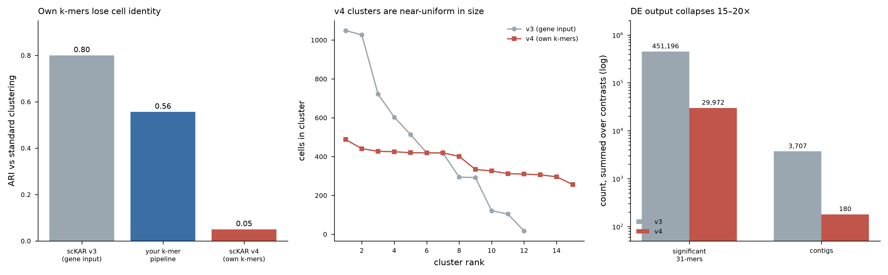

# scKAR on PBMC — v4, 5,580 cells clustered on scKAR's own k-mers

Identical to `../v3-5580bc/` in every respect except one: cells are clustered on
**scKAR's own reference-subtracted 31-mer abundance** (`MODE=KMER_ABUNDANCE`)
rather than on the CellRanger gene-expression matrix. Same 5,580 UMI-deduplicated
per-cell FASTQs, same jellyfish counts, same adjacency, same reference
subtraction, same DE and assembly settings.

It exists to answer one question: **does scKAR's agreement with standard
cell-type calls survive when it is not given the standard pipeline's own input?**

It does not.



## The result

| clustering input | ARI vs standard clustering | ARI vs standard cell type |
|---|---|---|
| v3 — CellRanger gene matrix | **0.800** | 0.430 |
| v4 — scKAR's own 31-mers | **0.050** | **0.028** |
| (for scale) the k-mer pipeline's 28-mers | 0.556 | — |

Measured on the 5,497 barcodes shared by all arms. v4 also agrees with v3 at only
ARI 0.052, and with the k-mer pipeline at 0.060 — all at chance level.

v3's headline agreement was therefore an artifact of the shared input matrix, not
evidence that scKAR's k-mers carry cell identity. The comparison in
`../../pipeline-comparison-v2/` flagged this as a caveat; v4 measures it.

**This is not a general statement about k-mers.** The k-mer pipeline reaches
ARI 0.556 against the standard arm using its own 28-mer counts. The difference is
*reference subtraction*: removing everything present in the annotated
transcriptome removes the abundant transcript sequence that distinguishes cell
types, leaving a feature space dominated by repeats.

Corroborating signs:

- **Cluster sizes are near-uniform.** 15 clusters spanning 256–488 cells, against
  v3's 12 clusters spanning 17–1,049. There is no small platelet cluster and no
  dendritic-cell cluster — the structure that gene expression resolves cleanly.
- **DE output collapses.** 13,949 distinct significant 31-mers and 161 distinct
  contigs, against v3's 75,179 and 1,838.
- **What survives is almost entirely repeat.** Of 172 placed contigs, **137
  (79.7%) sit on `chrUn_GL000220v1`**, the 45S rDNA repeat scaffold — higher than
  v3's 57%. Only 6 contigs map to a unique locus and only 30 overlap a gene.

## Results

15 Leiden clusters at resolution 0.6, 13 bipartitions.

| | summed over contrasts | distinct |
|---|---|---|
| significant 31-mers | 29,972 | **13,949** |
| contigs | 180 | **161** |

Per-bipartition significant k-mers range 301–5,713; contigs 0–51.
Full table in `results/de_kmers/`, annotation in `results/annotation/`.

## Deviation: scKAR's own k-mer clustering mode cannot run at this scale

`MODE=KMER_ABUNDANCE` calls `merge_adj_for_clustering`, which holds a
`map<string, vector<double>>` — a **dense** vector of `cell_count` doubles for
every k-mer — in memory, then writes a dense CSV. With 21,235,492 adjacency
k-mers and 5,580 cells that is roughly **948 GB of RAM** and a multi-terabyte
file. The mode is usable at the ~118-cell scale scKAR was published on; it is not
usable on droplet data. `run_stages.sh` also never implemented the branch at all —
only `run.sh` does.

This run therefore builds the same matrix **restricted to k-mers present in at
least 56 cells** (1% — the same floor `MIN_ROW_THREDSHOLD` applies downstream),
which leaves 139,830 of the 21.2 M k-mers and a 1.7 GB matrix. scKAR's own
`graph-clustering.py` then runs on it unchanged.

The filter is **label-free**: it uses only per-k-mer prevalence and nothing from
any clustering, annotation or the gene-expression arm, so the independence that
makes the ARI meaningful is preserved. It does mean v4 is scKAR-with-a-prevalence
-filter rather than stock scKAR, and the retained k-mers are the *most* prevalent
ones — if anything the subset most favourable to recovering cell structure.

Prevalence distribution of the 21,235,492 adjacency k-mers (mean 3.39 cells each):

| floor | k-mers retained |
|---|---|
| ≥5 cells | 700,452 |
| ≥28 (0.5%) | 202,742 |
| **≥56 (1%)** | **139,830** |
| ≥112 (2%) | 100,389 |
| ≥279 (5%) | 57,033 |

## Other deviations

Unchanged from v3: per-cell demultiplexing and UMI deduplication are our
additions (scKAR has no UMI model), and the three Rocky 9 patches in `patches/`
are required for the pipeline to run at all. See `../v3-5580bc/README.md`.

## Layout

```
results/de_kmers/    per-bipartition A/B/filtered DE 31-mer tables (gzipped)
results/contigs/     assembled contigs, empty arms included
results/annotation/  contig_annotation.tsv, annotation_summary.tsv, all_contigs.psl.gz
results/v4_summary.png
metadata/            cluster.csv, bipartitions/, tpm_sum.csv, cluster_tpm.csv, config.env
scripts/             01-build_kmer_matrix.py, 02-collect_contigs.py,
                     03-annotate_contigs.py, 04-run_stages.sh, env.sh
patches/             the three scKAR patches
logs/                v4_run_report.txt
```
