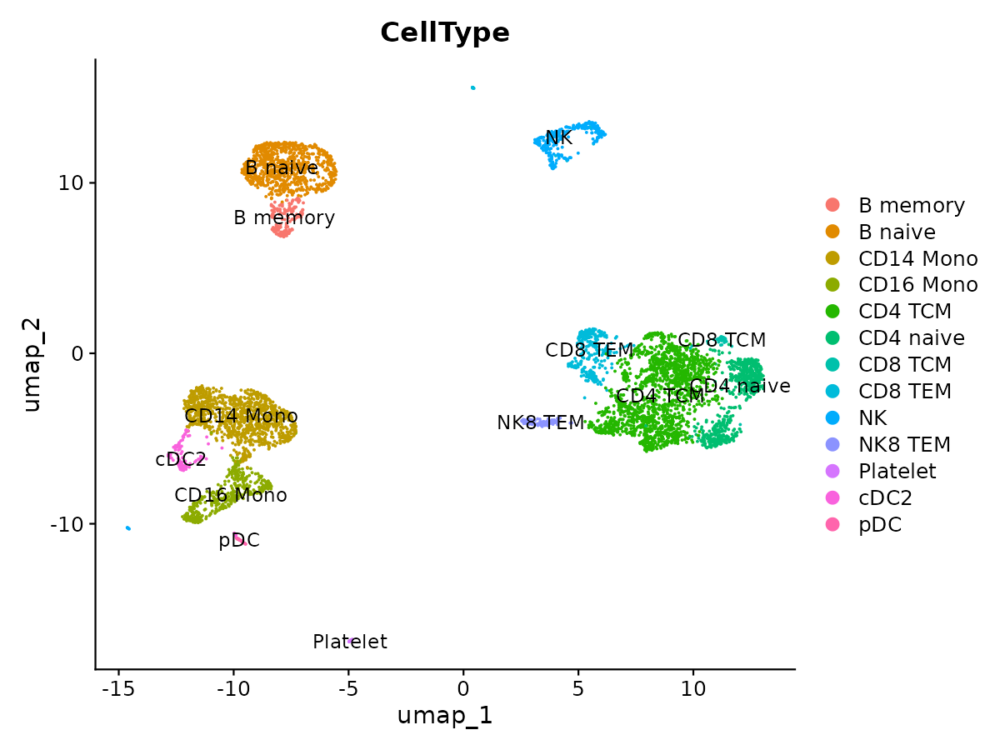
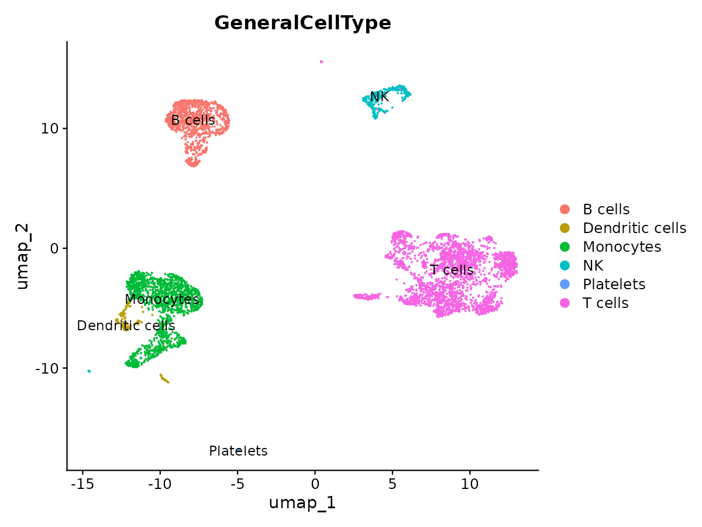
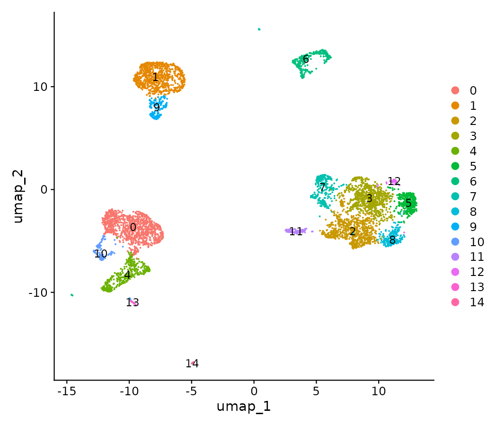
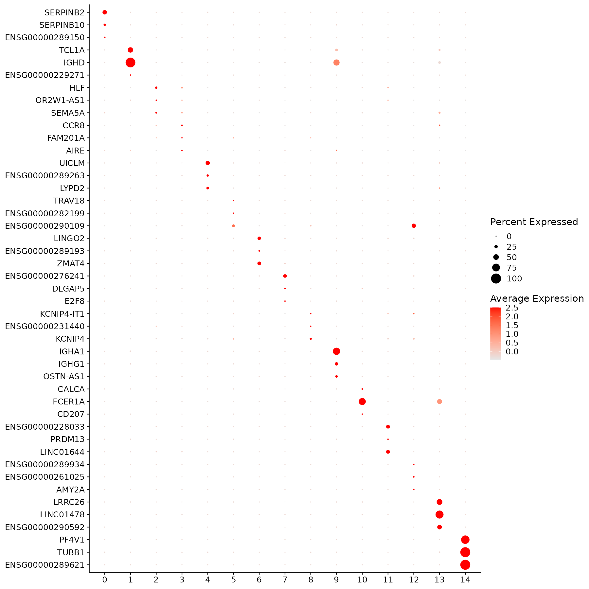
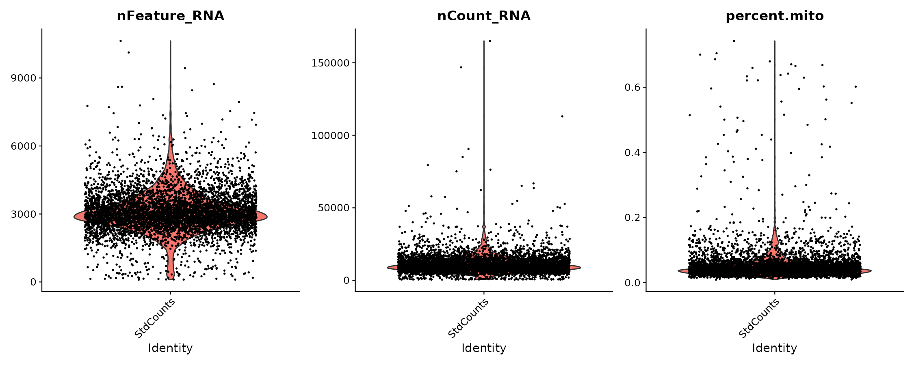
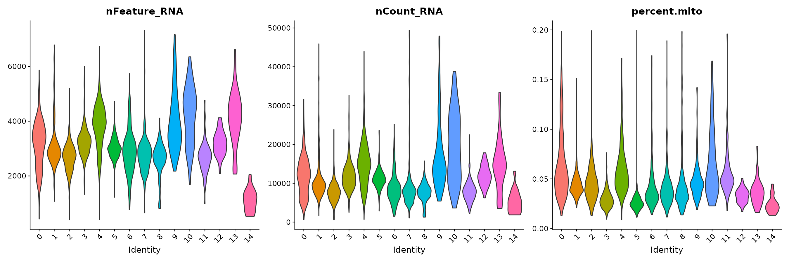

# Standard gene-based pipeline — 5K Human Donor4 PBMC

Reference arm of the alignment-free benchmarking project: the conventional
CellRanger → Seurat workflow on 10x Genomics *5K Human Donor4 PBMC 3' GEM-X*.
This is the arm the two alignment-free pipelines
(`mykmerpipeline-PBMC/`, `scKAR-PBMC/`) are scored against — its per-barcode
cell-type calls in `metadata/barcode_celltype_STD.csv` are the external arbiter
for the comparison.

## Input

CellRanger `filtered_feature_bc_matrix.h5` (GRCh38), 38,606 genes × 5,722 barcodes.
Gene-level UMI counts, barcode- and UMI-collapsed by CellRanger.

## Method

`scripts/std_seurat_run.R`, a batch-executable driver that reproduces
`scripts/std_seurat.ORIGINAL.R` with identical parameters. Steps, in order:

1. `Read10X_h5` → `CreateSeuratObject(min.cells = 1, min.features = 100)`
2. `percent.mito` from the 13 `^MT-` features
3. QC filter `nCount_RNA <= 5e4 & percent.mito <= 0.2`
4. `NormalizeData(LogNormalize, scale.factor = 7000)`
5. `FindVariableFeatures(vst, nfeatures = 2000)` → `ScaleData` → `RunPCA`
6. `RunUMAP` / `FindNeighbors` on PCs 1–30, `FindClusters(resolution = 0.4)`, `set.seed(7)`
7. `FindAllMarkers(only.pos = TRUE, logfc.threshold = 0.25)` at cluster level and at
   `GeneralCellType` level
8. Cell-type labels attached per barcode from `metadata/barcode_celltype_STD.csv`

Note on step 8: labels are joined **by barcode**, not re-derived from the new
clustering, so the labels are stable even though this rerun used Seurat 5.5.1
rather than the Seurat 4 stack of the original run.

## Results

| Stage | Count |
|---|---|
| Barcodes in the h5 | 5,722 |
| After `min.features = 100` | 5,678 cells (29,567 genes) |
| After QC filter | **5,580 cells** |
| Clusters at resolution 0.4 | **15** |
| Significant cluster-marker rows (p_adj < 0.05) | 27,301 over 13,941 genes |
| Significant cell-type marker rows (p_adj < 0.05) | 15,821 over 12,155 genes |

Cluster sizes match the cell-type counts in `barcode_celltype_STD.csv`
one-for-one, i.e. this rerun reproduces the original clustering.

### Clusters and their cell types

| Cluster | CellType | GeneralCellType | Cells |
|---|---|---|---|
| 0 | CD14 Mono | Monocytes | 1065 |
| 1 | B naive | B cells | 845 |
| 2 | CD4 TCM | T cells | 814 |
| 3 | CD4 TCM | T cells | 748 |
| 4 | CD16 Mono | Monocytes | 415 |
| 5 | CD4 naive | T cells | 385 |
| 6 | NK | NK | 311 |
| 7 | CD8 TEM | T cells | 298 |
| 8 | CD4 naive | T cells | 227 |
| 9 | B memory | B cells | 161 |
| 10 | cDC2 | Dendritic cells | 111 |
| 11 | NK8 TEM | T cells | 109 |
| 12 | CD8 TCM | T cells | 43 |
| 13 | pDC | Dendritic cells | 31 |
| 14 | Platelet | Platelets | 17 |

Cell types collapse to six general classes: T cells 2,624 · Monocytes 1,480 ·
B cells 1,006 · NK 311 · Dendritic cells 142 · Platelets 17.

### Marker genes per general cell type (unique, p_adj < 0.05)

Monocytes 4,648 · B cells 3,350 · Dendritic cells 2,877 · T cells 2,830 ·
NK 1,342 · Platelets 774.

### Figures













## Why this arm matters for the comparison

Three properties make it the reference rather than just a third result:

- **Features are genes**, so markers are directly interpretable and can be
  matched against Azimuth PBMC panels without an alignment step.
- **Counts are UMI-collapsed**, so abundance reflects molecules, not reads. The
  k-mer pipeline (BKC) also uses UMIs; scKAR does not, because it has no UMI
  model. Keep that asymmetry in mind for any abundance-derived comparison.
- **Rare populations survive.** Platelets (17 cells) and pDC (31 cells) form
  their own clusters here. The k-mer pipeline at a 1%-of-cells prevalence floor
  recovers no platelet, dendritic, erythroid or HSPC cluster at all, and cannot
  separate CD4 from CD8 — those marker transcripts never clear the floor.

## Contents

```
results/clustering/   UMAPs (cluster / CellType / GeneralCellType), QC violins,
                      marker dot plot, PCA elbow — PNG and PDF
results/markers/      cluster_markers_sig.csv, celltype_markers_sig.csv
metadata/             umap_coords.csv (embedding + labels, the join key for
                      cross-pipeline figures), cells_per_celltype.csv,
                      cells_per_generaltype.csv, cluster_celltype_sizes.csv,
                      barcode_celltype_STD.csv, annotation_STD.csv
scripts/              std_seurat_run.R (driver used), std_seurat.ORIGINAL.R
logs/                 run_log.txt (full stdout incl. sessionInfo)
```

Not included, as regenerable: `std_seurat5.rds` (107 MB) and the
`Azimuth_FeaturePlots_AllCellTypes.pdf` panel sweep (95 MB).
